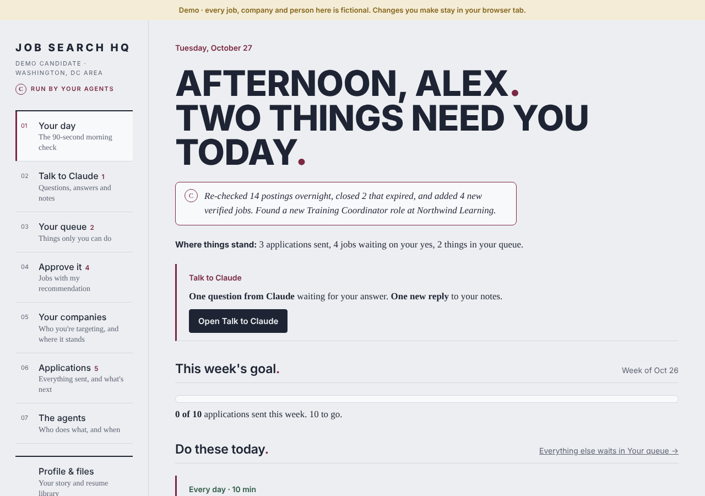
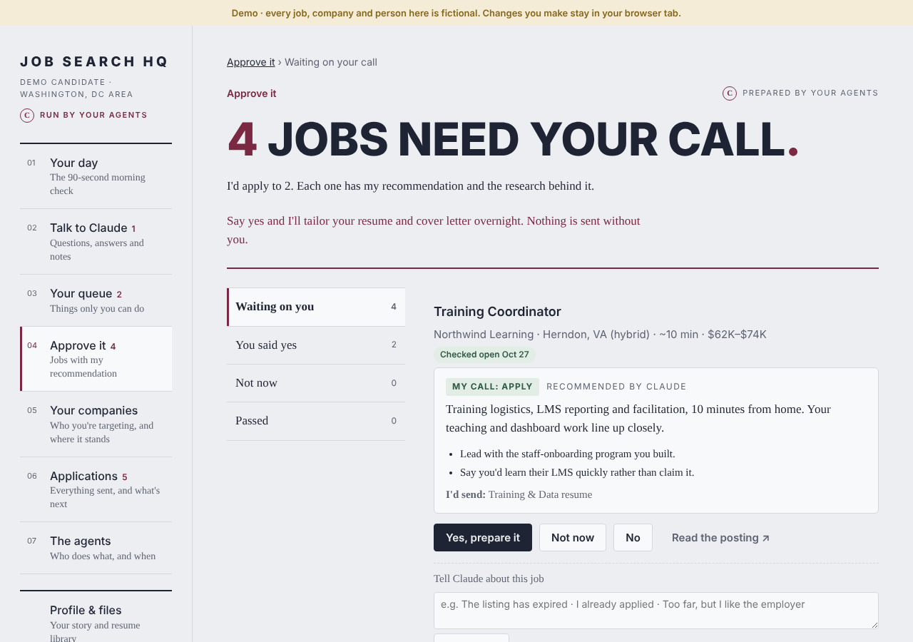
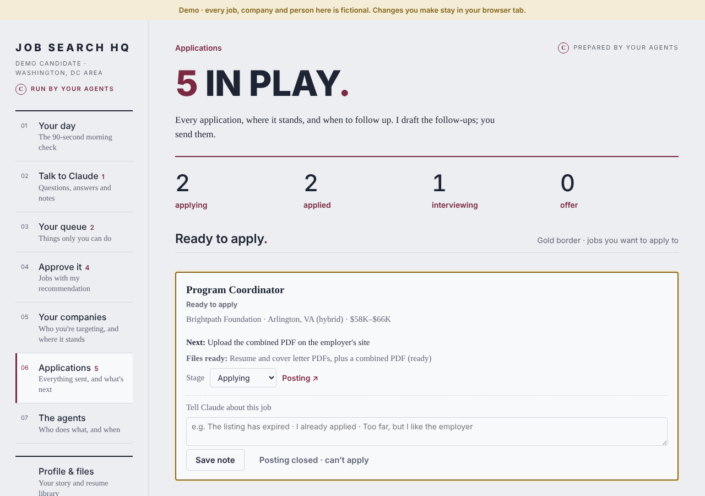
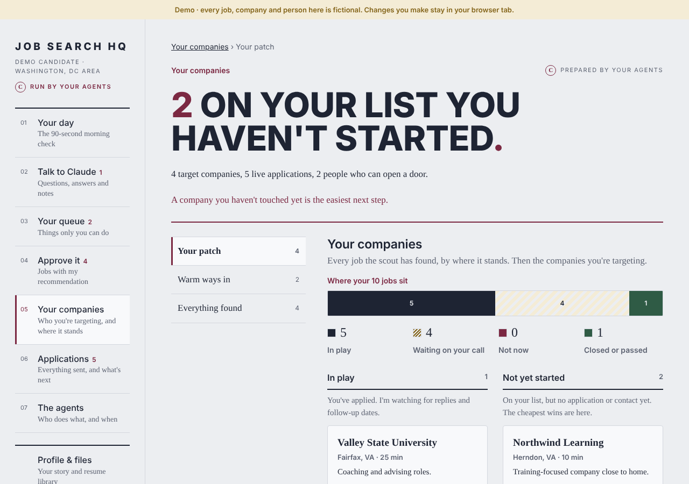
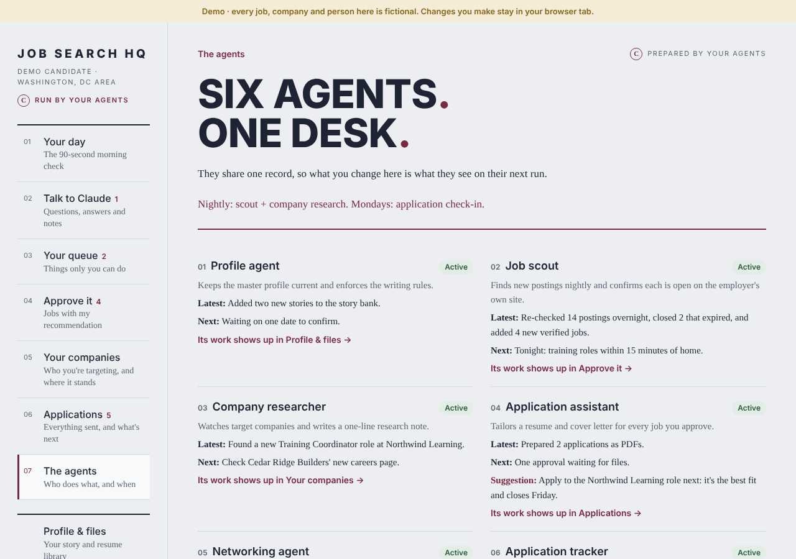

# Job Search HQ: a multi-agent AI job search system

I built this system with Claude to run my own job search as I relocate to the Washington, DC area. A team of AI agents works every night and throughout the day: it finds openings, confirms they are still open, recommends which ones to apply to, tailors a resume and cover letter for each approved job, and tracks every follow-up. **I stay in charge.** Nothing is submitted or sent without my approval.

This repository is a **showcase version**. The dashboard runs on fictional demo data, and none of my real applications, contacts or notes are included.

**[Open the live demo](https://rebekahj6.github.io/job-search-agents/)** (fictional data; any changes stay in your browser tab)

## What it does

| Agent | What it does |
|---|---|
| **Profile agent** | Keeps one master profile (experience, dates, preferences and writing rules) that every other agent reads first, so nothing is invented or contradicted. |
| **Job scout** | Searches nightly, confirms every posting is open **on the employer's own careers site** (aggregators are often out of date), and ranks roles by commute and fit. |
| **Company researcher** | Watches a list of target companies and adds a one-line research note to each. |
| **Application assistant** | Tailors a resume and a one-page cover letter for every job I approve, then saves them as PDFs. |
| **Networking agent** | Suggests warm introductions and drafts short notes in my voice. I send them myself. |
| **Application tracker** | Tracks every application, sets follow-up dates and drafts follow-up notes. |

## How I work with it

- **Your day:** a 90-second morning check showing what needs me today, overnight results and a weekly application goal.
- **Approve it:** each new job comes with the agent's recommendation (Apply, Hold or Skip), the reasoning and research. One click says "Yes, prepare it."
- **Applications:** jobs ready to apply to sit at the top with a gold border. Submitted applications have a black border. Closed postings fade to grey.
- **Talk to Claude:** a two-way message board. The agents ask me questions they can't answer from the profile, and I leave notes and corrections that they act on.

| Approve it | Applications |
|---|---|
|  |  |

| Your companies | The agents |
|---|---|
|  |  |

## Design principles

1. **A human in the loop for everything that matters.** Agents draft; I review and send.
2. **One source of truth.** A single master profile holds every fact and writing rule, so resumes and letters stay consistent.
3. **Verify before showing.** A posting only reaches me after it has been confirmed open on the employer's own site.
4. **Privacy by default.** Real data lives in a private database. This public version uses fictional data only.
5. **Learn from feedback.** My reactions and notes change what the scout looks for and how the letters are written.

## How it's built

- **Claude** (Anthropic) runs the agents as scheduled tasks: a nightly scout and research run, an hourly daytime check for my notes and approvals, and a weekly application check-in.
- **The dashboard** is a single HTML page (`index.html`) with a small shared database for jobs, tasks, companies, contacts and messages. In this demo, `demo.js` supplies fictional data in its place.
- **Documents** are generated as PDFs from one shared content library, so every tailored resume uses the same verified facts.

See [docs/how-it-works.md](docs/how-it-works.md) for more detail.

## About me

I'm Rebekah Jackson. I work where people, programs, technology and data meet. I'm both highly technical and very personable, and I'm looking for roles in training, AI enablement, implementation and program coordination in the Washington, DC area.

- LinkedIn: [linkedin.com/in/rebekah-thurston-jackson-78886a115](https://www.linkedin.com/in/rebekah-thurston-jackson-78886a115)
- Website: [rebekahjackson.com](https://rebekahjackson.com)
